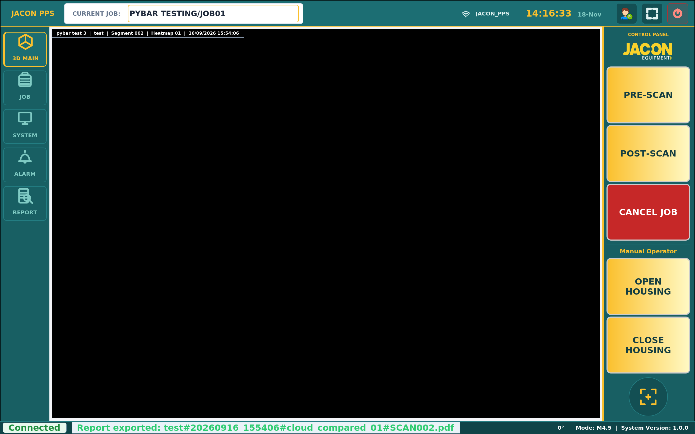

# Jacon Intelijet PPS — Operator Manual

Software version: 1.0.0 (Mode M4.5) · Manual revision: 2026-11-18

This manual is for the people who run the Intelijet PPS shotcrete-thickness scanner every day, and for the technicians who support them. It is written to be read on the tablet or printed.

| # | Chapter | Read it when… |
|---|---------|---------------|
| 01 | [Introduction](01_introduction.md) | You are new to the machine. |
| 02 | [Safety Warnings](02_safety.md) | **Before operating for the first time — mandatory.** |
| 03 | [Installation & Kiosk Mode](03_installation.md) | Setting up a new tablet (technicians). |
| 04 | [Starting, Logging In & Shutting Down](04_startup_shutdown.md) | Every shift. |
| 05 | [The Screens](05_screens.md) | You want to know what a button, light or tab does — including the clock and the network indicator. |
| 06 | [Projects & Jobs](06_projects_and_jobs.md) | Creating a project or job, scheduling it, choosing the current job. |
| 07 | [Scanning](07_scanning.md) | Running Pre-Scan / Post-Scan and reading the heatmap. |
| 08 | [Reports & Past Scans](08_reports.md) | Viewing PDF reports, old scans, comparing two scans by hand. |
| 09 | [Status Lights, Notifications & the ALARM Log](09_monitoring_alarms.md) | Something on the screen turned red. |
| 10 | [Troubleshooting & Fixing Errors](10_troubleshooting.md) | The machine is not doing what you expect, or an alarm code appeared. |
| 11 | [Maintenance & Updates](11_maintenance.md) | Updating software, freeing disk space, calibrating (technicians). |
| 12 | [Data Sync Between Tablets](12_data_sync.md) | Two tablets share the same jobs. |
| 13 | [USB Data Copier](13_usb_copier.md) | Copying scans/reports to a USB stick. |
| 14 | [Appendix](14_appendix.md) | Glossary, file names, error-code list, contacts. |

## How this manual shows things

- **Bold text** is a button, tab or label exactly as it appears on the screen — e.g. **PRE-SCAN**, **JOB**, **Set Zero Position**.
- Screenshots were captured from the real software. Photos of the machine itself are marked `[PHOTO: …]` and will be added later.
- `⚠️ NEEDS CONFIRMATION` marks a fact that still has to be confirmed by the machine owner before this manual is final. Do not treat those lines as instructions yet.
- **Restart App** (used in many fix guides) means: tap the red **power** button → **Yes**, then tap the **Intelijet** icon (or switch the kiosk tablet off and on). Tapping the icon while the app is open also restarts it.

