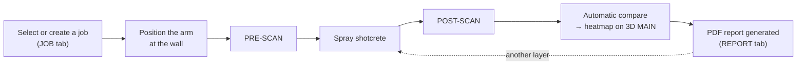

# 1. Introduction

## What the machine does

Intelijet PPS measures the **thickness of sprayed concrete (shotcrete)** on a tunnel wall.

1. Before spraying, the scanner records the bare surface — the **Pre-Scan**.
2. After spraying, it records the surface again — the **Post-Scan**.
3. The software compares the two scans automatically. The difference between them is the shotcrete thickness at every point.
4. The result is shown as a colour **heatmap** in 3D (green = thickness within target, red = too thin, blue = too thick) and exported as a PDF **Shotcrete Thickness Report** (average thickness, sprayed volume, area completed, distribution chart).

One Pre-Scan followed by any number of Post-Scans is called a **segment**. Each Post-Scan produces its own heatmap and report, so you can spray in layers and check progress after each pass.

## Main parts

| Part | What it is |
|------|-----------|
| **Scanner (Lidar)** | SICK LMS511 laser scanner (Laser Class 1 — eye-safe). It sweeps the tunnel surface while the Housing rotates. |
| **Housing** | Motor-driven cover that holds the scanner. During a scan it rotates open from about 12° to 135° and back; it can also be opened/closed by hand from the screen. |
| **Hydraulic arm** | 2-joint arm with one cylinder that carries the Housing close to the wall to be scanned. Independent from the Housing motor. |
| **Encoder** | Measures the Housing angle. Shown on the **SYSTEM** tab and at the bottom right of the status bar. |
| **PLC + PCAN gateway** | Drive the Housing motor and report machine signals to the tablet. |
| **Router** | The machine's own Wi-Fi/LAN router. The tablet reaches the Lidar and the PCAN gateway through it. |
| **Tablet (HMI)** | 10-inch touchscreen running the Intelijet software. Two tablets can share the same job data (Chapter 12). |
| **Host vehicle** | The off-highway carrier the PPS unit is mounted on. Its **emergency** control and its **ignition / battery master (mass) switch** are the machine's real emergency and power-off controls — see Chapter 2. |

How the parts talk to each other (useful when something shows DISCONNECTED):

```
Tablet --Wi-Fi/LAN--> Router --Ethernet--> Lidar (192.168.82.121)
                       Router --Ethernet--> PCAN Gateway --CAN bus--> PLC --> Housing motor + Encoder
```

So: no network on the tablet ⇒ Lidar **and** PCAN/PLC/Encoder all disconnected. PCAN down ⇒ PLC and Encoder also down.

`[PHOTO: the machine with the Housing, hydraulic arm and tablet labelled]`

## A normal working cycle in one picture



Details: Chapter 6 (jobs), Chapter 7 (scanning), Chapter 8 (reports).

## Who does what

| Role | Login | Can do |
|------|-------|--------|
| Viewer (default, no login) | none | Everything needed to scan: jobs, Pre-/Post-Scan, housing, reports, alarms. Can switch **Ground**, **Back Wall**, **Auto Report** and **Debug Mode**. |
| Operator / Engineer | password | Same as Viewer. |
| Admin | password | Additionally change the locked processing stages (**Edge Trim**, **Align**, **Keypoint**, **Auto Compare**) on the **SYSTEM** tab. |

Passwords are issued by your administrator.
