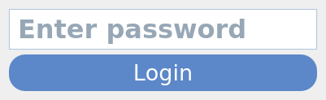
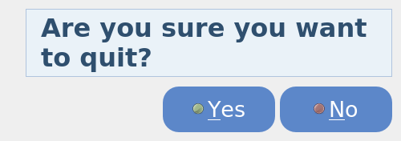

# 4. Starting, Logging In & Shutting Down

## 4.1 Starting

**Kiosk tablet:** switch the tablet on. It boots straight into the app.

**Desktop tablet:** tap the **Intelijet** icon.

What you will see:

1. If **Debug Mode** is ON (SYSTEM tab, Chapter 5.5), a small terminal window titled *"Intelijet - đang khởi động..."* shows start-up messages. Ignore it; it is for technicians. With Debug Mode OFF it does not appear.
2. The main screen appears full-screen on the **3D MAIN** page (up to about 2 minutes).
3. The header shows the **clock** and the **network indicator** (Wi-Fi name or LAN icon). A red **NO NETWORK** means the tablet is not on the machine's router — fix that first (Chapter 10.1).
4. Within a few seconds the status bar at the bottom shows **Connected** (green) once all four devices are talking to the tablet, and the **PRE-SCAN** / **POST-SCAN** buttons turn from grey to yellow.

If the buttons stay grey or the badge says **Disconnected**, go to the **SYSTEM** tab to see which device is missing, and open the **ALARM** tab — each missing device raises its own alarm with a fix guide (Chapters 9 and 10).

**Every tap on the icon restarts the app from scratch.** If the app is already running, tapping the icon again stops it and starts a fresh copy — it does not bring the running one to the front. Do not tap it during a scan.

**First start after installation** takes a few minutes longer (the software builds itself once).

## 4.2 Full screen

The **⛶** button (top right) toggles full screen. The app starts full-screen; use this only if a window was resized by accident.

## 4.3 Logging in (optional)

Normal scanning needs no login. Log in only to change the locked processing stages on the **SYSTEM** tab (admin).

1. Tap the **user icon** (top right).
2. Type the password with the on-screen keyboard and tap **Login**.

- Wrong password → message *Wrong password*; try again.
- When logged in, the icon changes to a "logout" icon. Tap it again to log out (back to Viewer).
- Settings you changed stay as they are after logging out.

## 4.4 Shutting down

1. Tap the red **power** button (top right).
2. Answer **Yes** to *Are you sure you want to quit?*

3. If a report is still being generated, the app waits a few seconds for it to finish, then closes.
4. On a kiosk tablet the screen goes dark; you can now switch the tablet off. On a desktop tablet you return to the desktop.

**Exit does not stop the Housing or the arm.** Use the vehicle's ignition / emergency controls for that (Chapter 2).

## 4.5 The on-screen keyboard

A keyboard pops up whenever you tap a text field (job name, search box, password). It floats above the app and can be dragged. It hides again when you tap outside the field. If it does not appear, see Chapter 10.
