# 5. The Screens

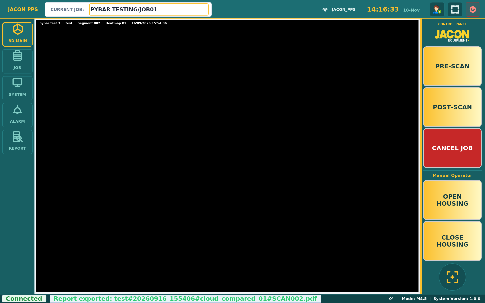

The screen has four fixed areas: the **header** (top), the **side navigation** (left), the **status bar** (bottom), and the **page** in the middle, which changes with the tab you choose.

## 5.1 Header

| Item | What it does |
|------|-------------|
| **JACON PPS** | Brand label only. |
| **CURRENT JOB:** dropdown | The job every new scan is saved to. Lists only jobs that are on the **Work Schedule** (Chapter 6). Tap to change; you are asked to confirm. |
| **Network indicator** | Shows how the tablet is connected to the machine's router: Wi-Fi (name + signal bars) and/or LAN cable — or a red **NO NETWORK**. See 5.1.1. |
| **Clock** | Current time (HH:MM:SS, yellow) and date (day-month). See 5.1.2. |
| **User icon** | Log in / log out (Chapter 4.3). |
| **⛶** | Full screen on/off. |
| **Power (red)** | Exit the app (Chapter 4.4). |

The ticked line in the open dropdown is the current job.

### 5.1.1 Checking the network connection

The tablet reaches the Lidar and the PCAN gateway (and through it the PLC and encoder) **through the machine's router**. The indicator in the header tells you at a glance whether that link is up. It refreshes every few seconds.

| What you see | Meaning |
|--------------|---------|
|  | Connected over **Wi-Fi**. The text is the Wi-Fi network name (SSID). It should be the machine's router, not another network. |
|  | Wi-Fi **and** a LAN cable are both connected. |
|  | Connected by **LAN cable** only. |
|  | **NO NETWORK** (red) — neither Wi-Fi nor LAN. The Lidar and PLC cannot be reached: expect every device on the SYSTEM tab to go DISCONNECTED and scans to be locked. |

Wi-Fi signal bars: **3 bars** = good (−60 dBm or better), **2 bars** = fair (−60 to −70 dBm), **1 bar** = weak (below −70 dBm). With 1 bar devices may drop in and out — move closer to the router or use a LAN cable.

Hold your finger on the indicator to see a tooltip with the Wi-Fi name and signal strength in dBm.

If you see **NO NETWORK** → Chapter 10.1.

### 5.1.2 Checking the time

The clock shows the time the software is using, updated every second. **This is the time written into every scan file name and every PDF report.** Before the first scan of the shift, check it matches your watch/phone.

- If the time or date is wrong, fix the tablet's own clock (technician: Ubuntu **Settings → Date & Time**), then **Restart App**.
- If the app's time zone does not match the tablet's, the app raises **SYSTEM-TIME-001** at start-up (status bar and ALARM tab) — see Chapter 10.6.
- Scans taken while the time was wrong keep the wrong time in their file names and reports.

## 5.2 Side navigation

| Tab | Use it for |
|-----|-----------|
| **3D MAIN** | The 3D view of the last scan/heatmap and the scan control panel. The app returns here by itself as soon as a scan or compare result is ready. |
| **JOB** | Create projects and jobs, put jobs on the Work Schedule. |
| **SYSTEM** | Device connection lights, encoder reading, **Set Zero Position**, processing switches, storage usage. |
| **ALARM** | Log of every message the machine has produced, with a "how to fix" guide for coded errors. |
| **REPORT** | All scans of a job, PDF reports, heatmaps, manual compare. |

The highlighted (yellow-framed) icon is the current page.

## 5.3 3D MAIN page

### 3D view (centre)

Shows the most recent point cloud: the raw Pre-/Post-Scan right after scanning, or the colour heatmap after a compare.

A grey label at the top left of the view says which cloud is on screen: **Project | Job | Segment | Pre Scan / Post Scan / Heatmap nn | date-time**.

| Gesture | Result |
|---------|--------|
| One-finger drag | Rotate the view. |
| Pinch with two fingers | Zoom in / out. |
| Two-finger drag | Pan (slide) the view. |
| **Zoom Center** button (round, bottom of the control panel) | Reset the view: cloud centred, fitted to the screen, standard orientation. Use it whenever you get lost. |

The view is empty until the first scan of the session (or until you open one from the REPORT tab).

### CONTROL PANEL (right)

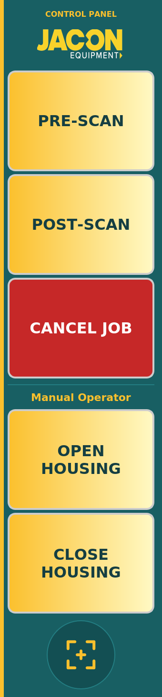

| Button | Action | Details |
|--------|--------|---------|
| **PRE-SCAN** | Start a Pre-Scan for the current job (new segment). Asks for confirmation. | Chapter 7. |
| **POST-SCAN** | Start a Post-Scan for the current job. No confirmation. | Chapter 7. |
| **CANCEL JOB** | Stop the running scan / Housing movement / compare. | Status bar shows *Job canceling…* then *Job canceled*. |
| **OPEN HOUSING** / **CLOSE HOUSING** (Manual Operator) | Move the Housing **while the button is held**. Release = stop. | For inspection and cleaning. Not needed for scanning — scans move the Housing automatically. |
| **Zoom Center** | Reset the 3D view. | |

Button looks and what they mean:

| Look | Meaning |
|------|---------|
| Yellow | Ready. |
| Grey | Locked: **PRE-SCAN**/**POST-SCAN** are grey until both **Encoder System** and **Lidar Sensor** are CONNECTED (SYSTEM tab). |
| Green frame | This action is running now. |
| Red frame | The last scan of this kind ended in an error — check the **ALARM** tab. |

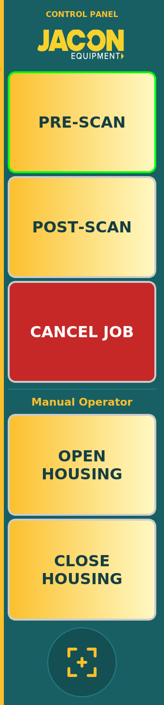 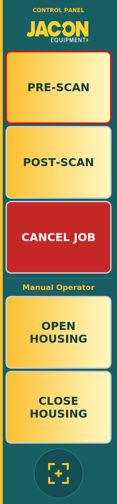 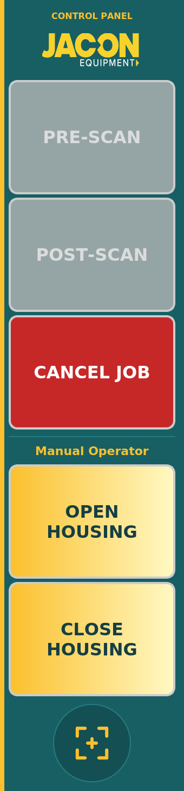

## 5.4 JOB page

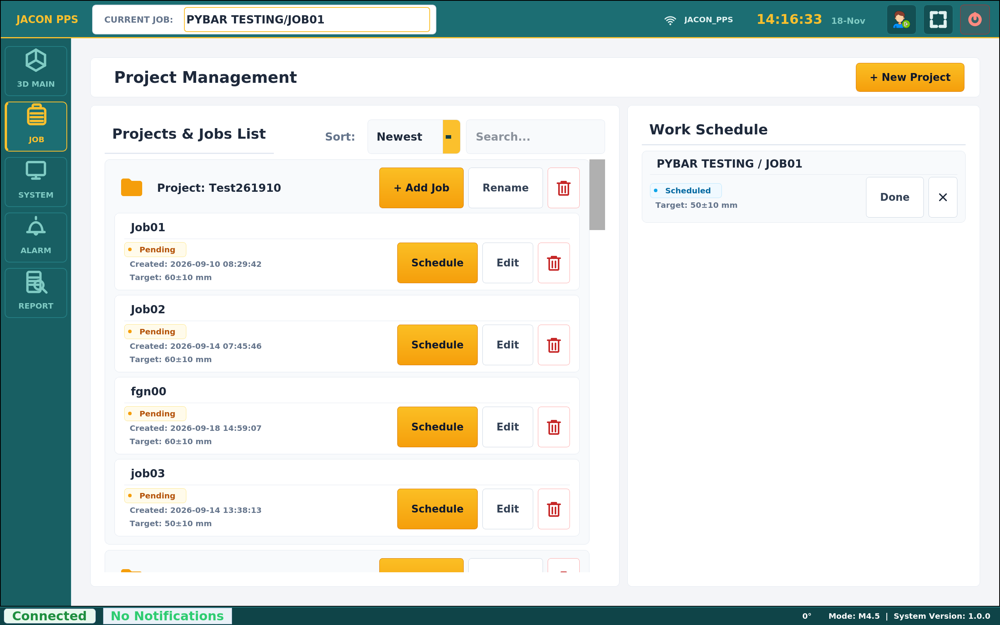

- **+ New Project** (top right) — creates a project.
- **Projects & Jobs List** (left) — one card per project with its jobs, a **Sort** choice, a **Search…** box, and per-row buttons.
- **Work Schedule** (right) — the jobs that can be selected as CURRENT JOB.

Full step-by-step use: Chapter 6.

## 5.5 SYSTEM page

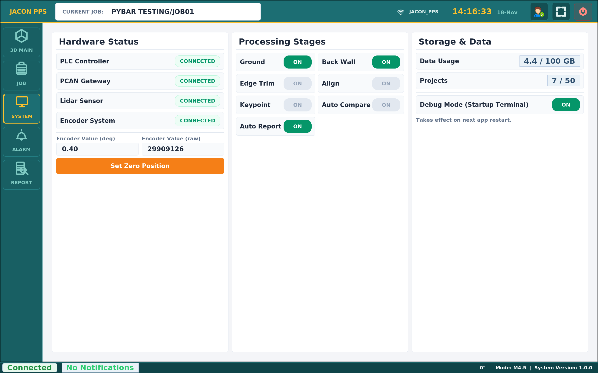

Three cards:

**Hardware Status** — one badge per device: **CONNECTED** (green), **DISCONNECTED** (red) or, for the Lidar only, **ERROR** (amber: reachable on the network but sending no scan data). Below: **Encoder Value (deg)** = current Housing angle, **Encoder Value (raw)** = raw counter, and **Set Zero Position** (calibrates 0° = Housing fully closed, Chapter 7.2).

**Processing Stages** — seven **ON/OFF** switches that control the compare. Green = ON. Grey = locked (admin login required) — the label on a locked switch is not meaningful; log in as admin to see its real ON/OFF state.

| Switch | What it does | Recommended | Who can change |
|--------|-------------|-------------|----------------|
| **Ground** | Removes floor/ground points before comparing. | ON | Anyone |
| **Back Wall** | Removes the tunnel face (back wall) points before comparing. Independent of Ground. | ON | Anyone |
| **Edge Trim** | Trims Post-Scan points that fall outside the Pre-Scan's area, so the edges of the result match the Pre-Scan. | as set by engineering | Admin |
| **Align** | Aligns the Post-Scan onto the Pre-Scan before comparing. | ON | Admin |
| **Keypoint** | Uses image keypoint matching to help alignment. | ON | Admin |
| **Auto Compare** | Compares automatically after every Post-Scan. | ON | Admin |
| **Auto Report** | Generates the PDF automatically after each compare. | ON | Anyone |

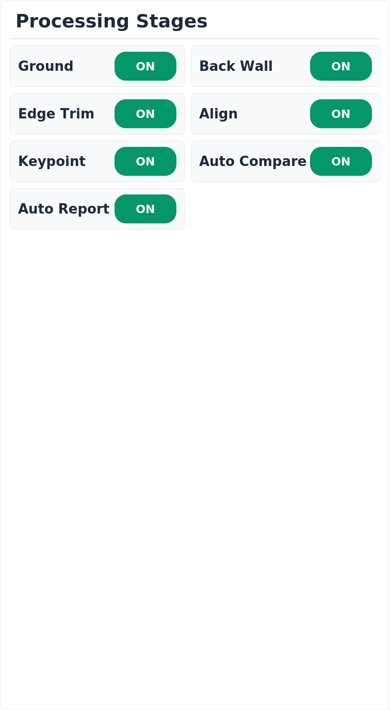

**Storage & Data** — **Data Usage** (size of all job data / automatic clean-up cap) and **Projects** (number of projects / cap) — see Chapter 11.2. **Debug Mode (Startup Terminal)** shows or hides the start-up terminal window; *takes effect on the next app restart*.

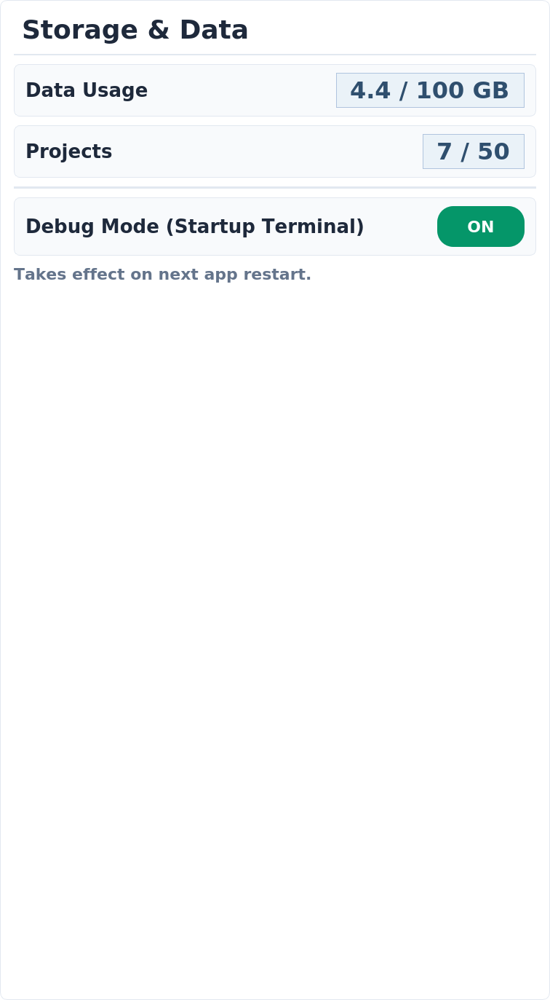

Switch positions are remembered between sessions.

## 5.6 ALARM page

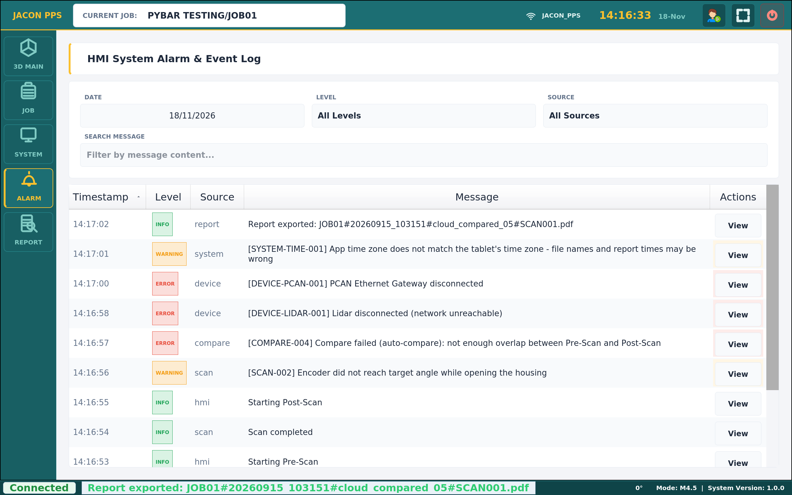

A table of every message (newest first) with filters for **DATE**, **LEVEL**, **SOURCE** and a text **SEARCH MESSAGE**. Tap **View** on a row (or double-tap the row) to open its detail and — for coded errors — the **How to check / fix** guide. Chapter 9.

## 5.7 REPORT page

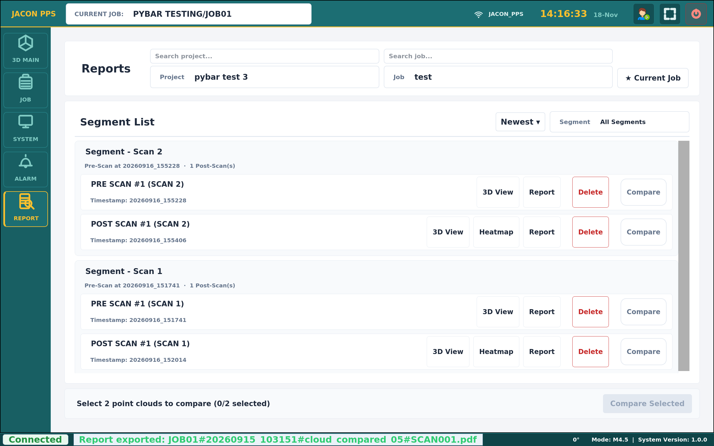

Choose a **Project** and **Job** (or tap **★ Current Job**), then every scan of that job is listed by **segment**. Each row has **3D View**, **Heatmap** (Post-Scans), **Report**, **Delete** and a **Compare** toggle. Chapter 8.

## 5.8 Status bar

| Part | Meaning |
|------|---------|
| **Connected / Disconnected** badge | Green only when **all four** devices (PLC, PCAN, Lidar, Encoder) are connected. |
| Message | The latest notification, coloured green (info), amber (warning) or red (error). Errors stay for at least 10 s. Long messages are cut with "…". Tap it to open the history list. |
| **nn°** | Current Housing angle from the encoder (≈ 0° when fully closed). |
| **Mode: … / System Version: …** | Machine mode and software version. |

## 5.9 On-screen keyboard

Appears automatically when a text field is tapped; can be dragged anywhere; hides when you leave the field.
