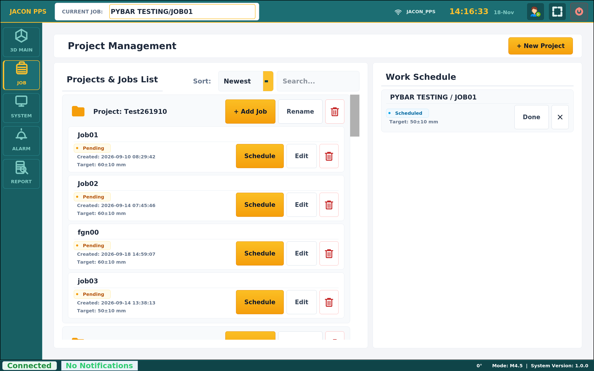
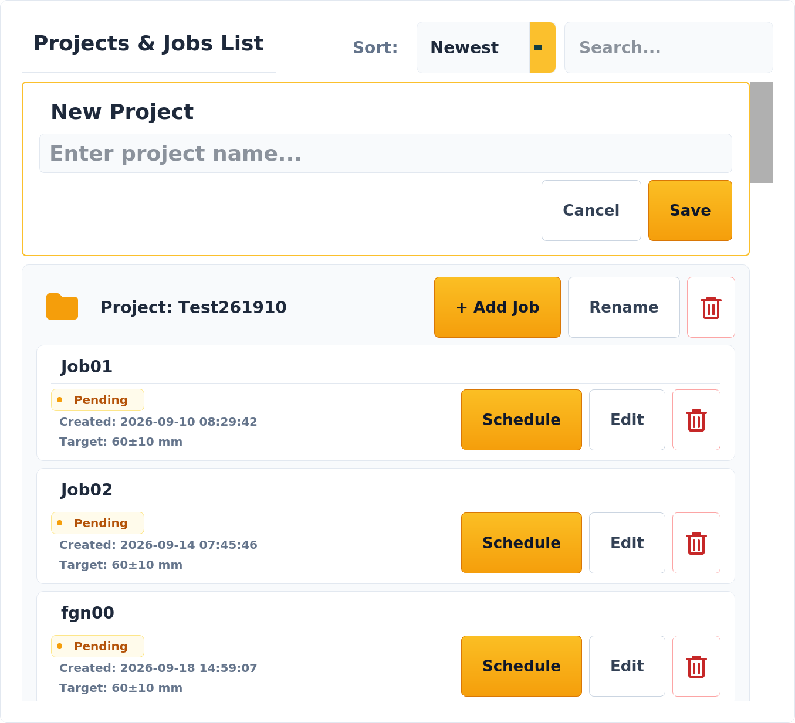
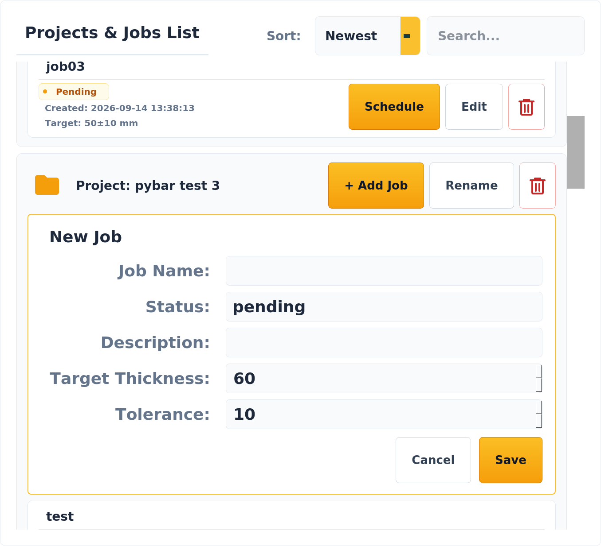
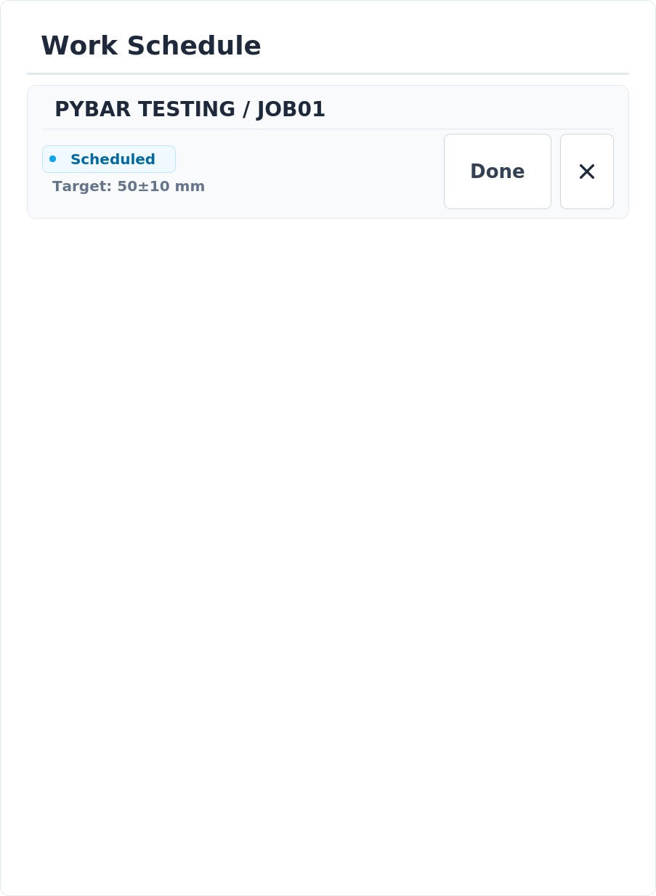
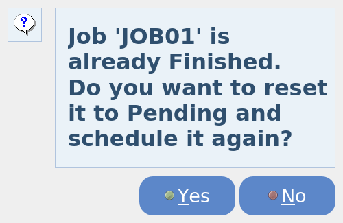
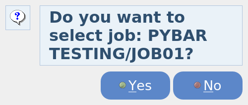
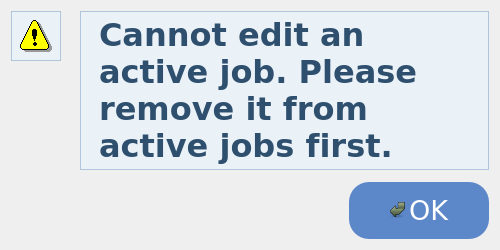
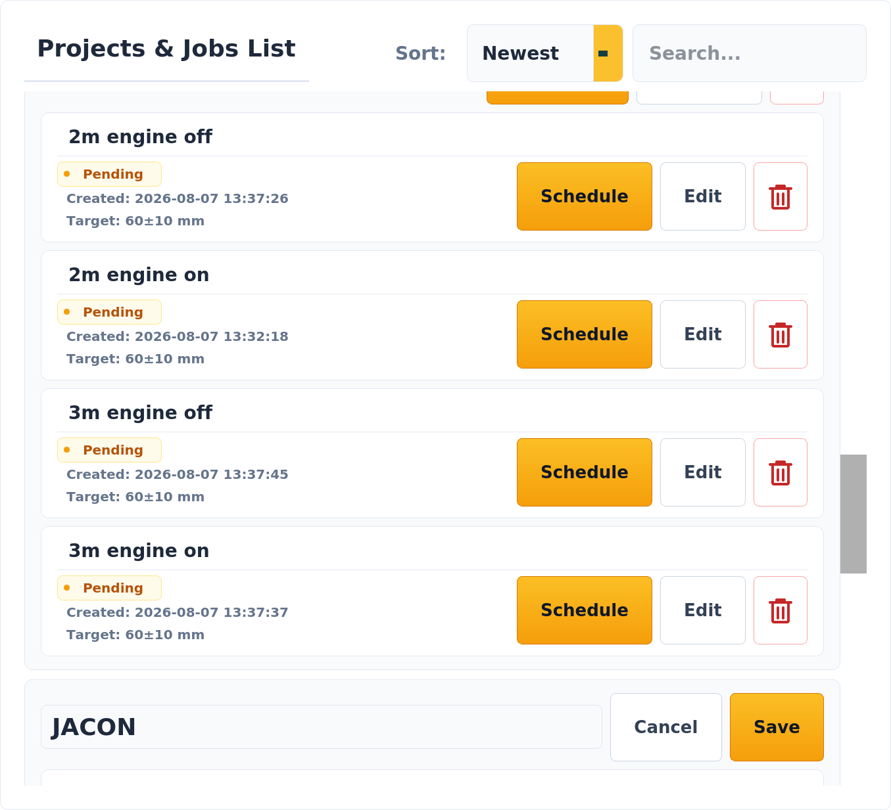

# 6. Projects & Jobs

Every scan is stored under a **job**, and every job belongs to a **project**.

- **Project** — usually the site, tunnel or date, e.g. `Kerem_260806`.
- **Job** — one area / heading you spray and check, e.g. `3m engine on jck leg`. A job holds all its Pre-Scans, Post-Scans, heatmaps and PDF reports.

A job goes through three states:

| Badge | Meaning |
|-------|---------|
| **Pending** (amber) | Created, not on the Work Schedule. Can be edited or deleted. |
| **Scheduled** (blue) | On the **Work Schedule** — selectable as CURRENT JOB and ready to scan. Cannot be edited or deleted while scheduled. |
| **Finished** (green) | Marked done with **Done**. Removed from the schedule. Can be re-scheduled later. |

All of this happens on the **JOB** tab.

## 6.1 Create a project

1. Tap **JOB** in the side navigation.
2. Tap **+ New Project** (top right). A **New Project** card opens at the top of the list and the keyboard appears.
3. Type the project name and tap **Save** (or Enter). **Cancel** discards it.

- A name that already exists is refused (*Project '…' already exists.*).
- Avoid `/` and `#` in names — they are used internally by the file names.
- Names starting with a dot (`.`) are hidden from all lists.

## 6.2 Add a job to a project

1. On the project's card, tap **+ Add Job**. A **New Job** panel opens inside that card.
2. Fill in the fields:

| Field | Meaning |
|-------|---------|
| **Job Name** | Required. Shown everywhere and used as the file-name prefix. |
| **Status** | Leave **pending**. (Scheduling sets it automatically.) |
| **Description** | Optional free text. |
| **Target Thickness** | Design shotcrete thickness in **mm** (default 60). Centre of the green band on the heatmap and "Shotcrete Applied" in the report. |
| **Tolerance** | Allowed ± deviation in **mm** (default 10). Half-width of the green band. |

3. Tap **Save**.

The job appears in the project's card with a **Pending** badge and its creation time.

## 6.3 Schedule a job (make it selectable)

1. On the job row tap **Schedule**.
2. The badge becomes **Scheduled**, and the job appears on the **Work Schedule** (right) and in the header's **CURRENT JOB** list.

You can schedule several jobs at once and switch between them from the header.

If the job was **Finished**, you are asked *Do you want to reset it to Pending and schedule it again?* — **Yes** re-opens it.

## 6.4 Select the current job

1. Tap the **CURRENT JOB** dropdown in the header.
2. Tap the job (format `Project/Job`).
3. Confirm *Do you want to select job: …?* with **Yes**.

The selected job stays current after a restart. Every new Pre-/Post-Scan is saved to it — **check it before you press PRE-SCAN.**

## 6.5 Finish or remove a job from the schedule

On the **Work Schedule** card:

- **Done** — marks the job **Finished** and takes it off the schedule. Use when the area is complete.
- **✕** (*Remove from Schedule*) — takes it off the schedule and sets it back to **Pending** (e.g. scheduled by mistake).

Both update the CURRENT JOB list at once. If you removed the job that was current, select another one.

## 6.6 Edit, rename, delete

| Action | Where | Rule |
|--------|-------|------|
| **Edit** job (name, status, description, thickness, tolerance) | job row | Not allowed while **Scheduled** — remove it from the schedule first. The **name** cannot be changed once the job has scans. |
| **Delete** job (and all its scans/reports) | job row (bin icon) | Not allowed while Scheduled. Asks for confirmation. Permanent. |
| **Rename** project | project card header | Not allowed while any of its jobs is Scheduled, or once the project has scans. |
| **Delete** project (with all its jobs) | project card header (bin icon) | Same rule as rename for scheduled jobs. Asks for confirmation. Permanent. |

 

Changing **Target Thickness / Tolerance** affects only heatmaps and reports made *after* the change.

## 6.7 Find a job

Type in **Search…** above the project list. Projects and jobs whose names contain the text are shown; the rest are hidden. Clear the box to see everything. **Sort** changes the order of the projects (e.g. newest first).

## 6.8 Where the data lives (for reference)

`data/Projects/<Project>/<Job>/` on the tablet — the scans (`.ply`), heatmaps and PDF reports of that job, plus `job_info.json` with the settings above. Two tablets keep this folder in sync (Chapter 12). Old projects are cleaned up automatically when the disk fills (Chapter 11).
