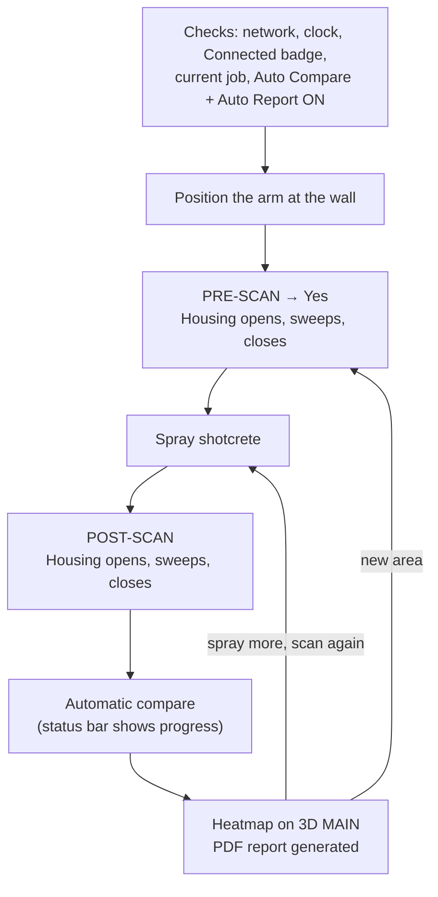
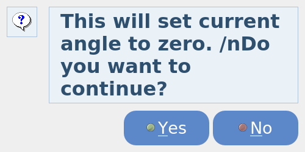
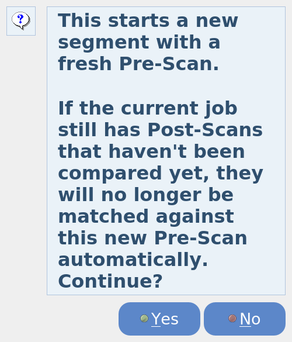
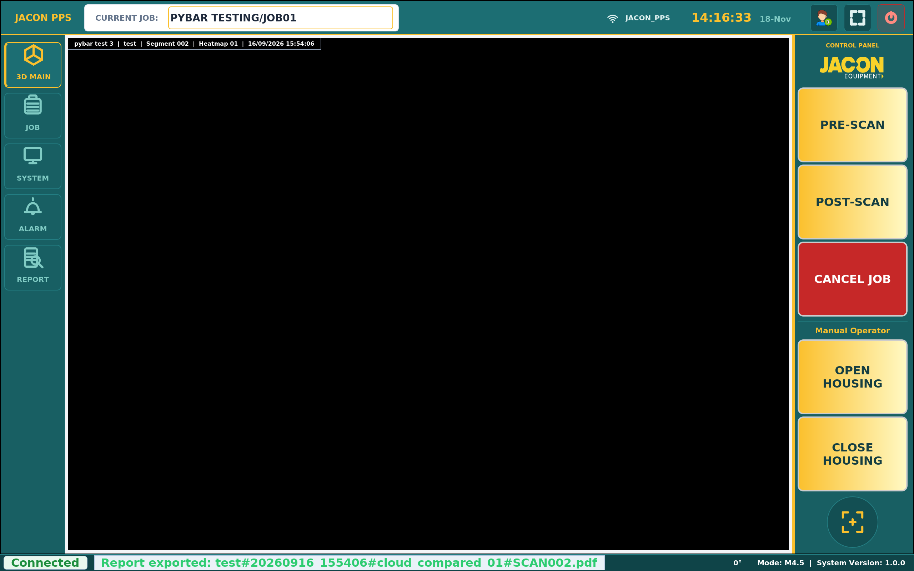

# 7. Scanning

Read Chapter 2 first. Keep everyone clear of the Housing while a scan runs.

## 7.1 Overview

A **segment** = one Pre-Scan + all the Post-Scans taken after it (until the next Pre-Scan). Scan numbers on the REPORT tab: `SCAN 1`, `SCAN 2`… = segment; `POST SCAN #1, #2…` = layer within the segment.

## 7.2 Before the first scan of the shift

1. **Network** (header): Wi-Fi name of the machine's router or the LAN icon — **not** a red **NO NETWORK** (Chapter 5.1.1).
2. **Clock** (header): time and date are correct (Chapter 5.1.2). They go into every file name and report.
3. **Status bar badge** shows **Connected**; on the **SYSTEM** tab all four devices read **CONNECTED**. If not → Chapter 9 / 10.
4. **PRE-SCAN / POST-SCAN** are yellow (not grey).
5. **CURRENT JOB** (header) is the job you want. Create/schedule it if needed (Chapter 6).
6. **SYSTEM** tab switches: **Auto Compare ON** and **Auto Report ON** for the normal automatic workflow (**Ground**, **Back Wall** and **Align** ON as well).
7. **Housing angle**: with the Housing fully closed, the angle at the bottom right of the status bar (and **Encoder Value (deg)** on the SYSTEM tab) should read close to **0°**. If it does not (for example after a power loss or mechanical work):
   - Make sure the Housing is fully closed — use **CLOSE HOUSING** (hold) if necessary.
   - Tap **Set Zero Position** and confirm **Yes**.

A wrong zero makes scans stop early or overrun (alarms SCAN-002 / SCAN-003).

## 7.3 Position the machine

Bring the Housing close to the wall to be scanned with the hydraulic arm, then keep the arm still for the whole scan.

> ⚠️ **NEEDS CONFIRMATION** — which controls move the arm (assumed: the host vehicle's own joystick/levers, not the tablet) and the recommended distance from the wall.

`[PHOTO: arm positioned at the tunnel wall]`

## 7.4 Pre-Scan (before spraying)

1. Tap **PRE-SCAN**.
2. Read the confirmation and tap **Yes**.

*Why the warning?* A Pre-Scan starts a **new segment**. Any Post-Scan you take later is compared against **this** Pre-Scan. Post-Scans of the previous segment that were not compared yet will not be compared automatically any more (you can still compare them by hand — Chapter 8.5).

3. The button gets a **green frame**, the status bar shows *Starting Pre-Scan*. The Housing opens slowly to about 135° while the scanner sweeps the wall (up to 2½ minutes). You can follow the angle at the bottom right of the status bar.
4. *Scan completed* appears; the Housing closes (about 30 s).
5. The app switches to **3D MAIN** and shows the raw point cloud. Check that the wall is covered; rotate/zoom if needed.

The Pre-Scan is saved as `PRE SCAN #1 (SCAN n)` of the job.

## 7.5 Spray

Spray the shotcrete layer. Do not move the vehicle or the arm if you want the Post-Scan to be compared automatically — the two scans must cover the same area from the same position.

## 7.6 Post-Scan (after spraying)

1. Tap **POST-SCAN** (no confirmation).
2. Same sequence as the Pre-Scan: green frame, Housing opens and sweeps, *Scan completed*, Housing closes, cloud shown.
3. **Automatic compare starts** (Auto Compare ON). The status bar shows *COMPARE xx%*. As soon as the result is ready the app switches to **3D MAIN** and shows the **heatmap**; the PDF is generated in the background:
   - *Report exported: …pdf* and **COMPARE DONE** — the PDF is ready on the REPORT tab (Auto Report ON).
   - If Auto Report is OFF you get **COMPARE DONE** and the heatmap only.
4. Read the heatmap (7.7). Spray more and take another Post-Scan if needed — each Post-Scan gets its own heatmap and report (`POST SCAN #2`, `#3`…).

Compare typically takes ½–2 minutes. You can rotate the view and switch tabs while it runs; a very large cloud may take longer (timeout after 2 minutes → COMPARE-002).

The heatmap and report carry the **time of the Post-Scan**, not the time the compare finished.

## 7.7 Reading the heatmap

Colours use the job's **Target Thickness ± Tolerance** (Chapter 6.2):

| Colour | Thickness | Meaning |
|--------|-----------|---------|
| **Green** | within target ± tolerance | OK. |
| **Red → yellow** | below target − tolerance (dark red under 20 mm) | Too thin — spray more here. |
| **Blue** | above target + tolerance | Too thick. |
| **Light blue** | above 300 mm (the machine's measurable limit) | Out of range / noise (e.g. equipment in view). |

The PDF report gives the numbers: average thickness, sprayed volume, area completed / total, distribution chart (Chapter 8.6).

## 7.8 Cancelling

Tap **CANCEL JOB** at any time. The Housing stops where it is, the scan or compare is abandoned (*Job canceling…* → *Job canceled*). To continue: close the Housing with **CLOSE HOUSING** if it was left open, then start the scan again.

## 7.9 Manual Housing operation

**OPEN HOUSING** / **CLOSE HOUSING** move the Housing only while your finger stays on the button; lifting it stops the movement. Use them to inspect or clean the scanner and to close the Housing after a cancelled scan. They are **not** part of the normal scan sequence.

> ⚠️ **NEEDS CONFIRMATION** — the software opens the Housing by itself during every scan. Confirm that operators are *not* expected to press OPEN HOUSING before PRE-SCAN.

## 7.10 If Auto Compare is OFF

Post-Scans are saved but not compared. Compare them later from the **REPORT** tab with **Compare Selected** (Chapter 8.5). Auto Compare can only be switched by an admin.
