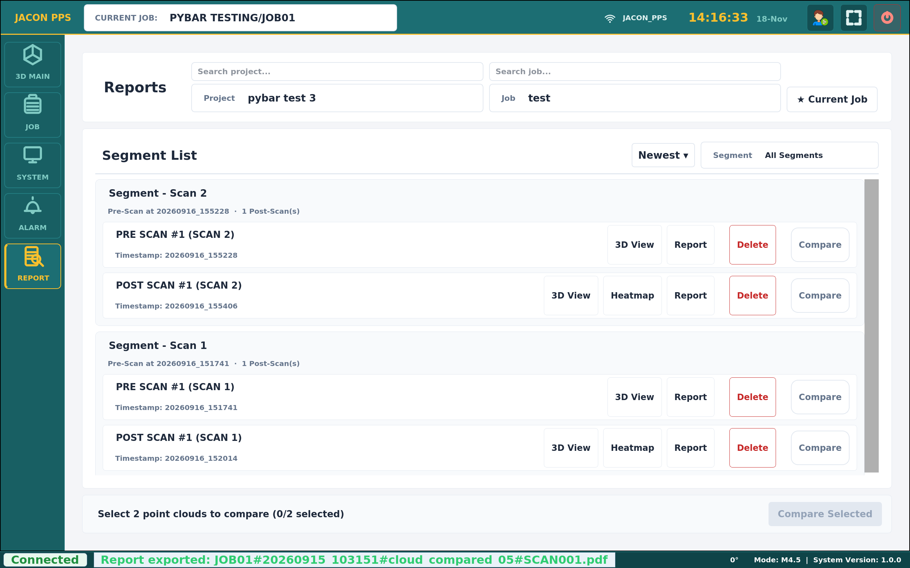
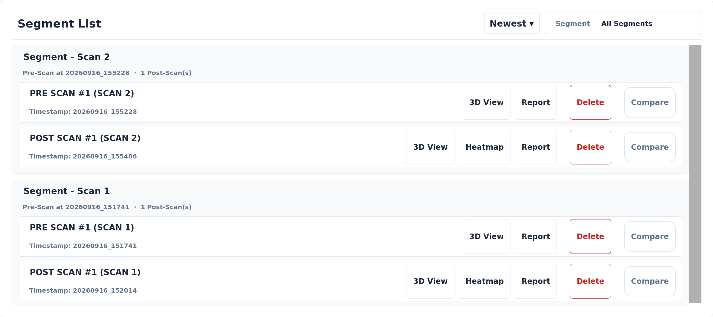
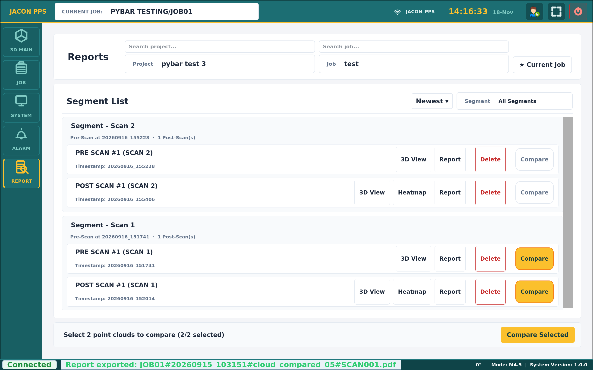
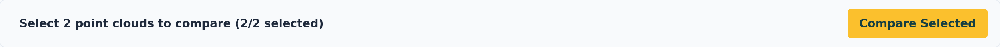

# 8. Reports & Past Scans

The **REPORT** tab lists every scan of a job and gives access to its heatmaps and PDF reports.

## 8.1 Choose a job

- **★ Current Job** — jumps to the current job (the one scans are saved to).
- **Project** / **Job** dropdowns — any job on the tablet, scheduled or not. Type in **Search project…** / **Search job…** to shorten the lists.

The list refreshes every time you open the tab, so scans from the other tablet appear once synced.

## 8.2 The segment list

Scans are grouped by **segment** (`Segment - Scan 1`, `Scan 2`…), each with its Pre-Scan time and number of Post-Scans. Use the **Segment** dropdown to show one segment only, and **Newest / Oldest** to change the order.

Row buttons:

| Button | On | Does |
|--------|----|------|
| **3D View** | any row | Loads the raw scan into the 3D MAIN view. |
| **Heatmap** | Post-Scan rows | Loads the compare result (heatmap) of that Post-Scan. Grey if that Post-Scan was never compared. |
| **Report** | any row | Opens the PDF report in the PDF viewer window. Grey if there is no report. On a Pre-Scan row it opens the newest report of the segment. |
| **Delete** | any row | Deletes that scan file after confirmation. **Permanent.** |
| **Compare** | any row | Marks the row for a manual compare (8.5). |

## 8.3 Viewing a PDF report

Tap **Report**. The PDF opens in a separate viewer window on top of the app (pinch/scroll to read, use its toolbar to zoom). Close the viewer window to return. Opening another report reuses the same window.

## 8.4 Where the files are

Each job folder (`data/Projects/<Project>/<Job>/`) contains, per scan:

| File type | Name pattern (example) |
|-----------|------------------------|
| Pre-Scan cloud | `Job#20260806_145804#pre_scan_cloud_01#SCAN001.ply` |
| Post-Scan cloud | `Job#20260806_150210#post_scan_cloud_02#SCAN001.ply` |
| Heatmap (compared cloud) | `Job#20260806_150210#cloud_compared_02#SCAN001.ply` — same time and number as its Post-Scan |
| Report | same name as the heatmap with `.pdf`, plus a `…#finalreport#SCAN001.pdf` copy (the latest report of the segment) |

`SCAN001` = segment, `_02` = Post-Scan number in that segment, the middle part = date/time of the Post-Scan. Copy them to USB with Chapter 13.

## 8.5 Comparing two scans by hand

Use this when Auto Compare was off, when you want to compare a Post-Scan against a different Pre-Scan, or to redo a compare.

1. Tap **Compare** on the Pre-Scan row → it turns yellow.
2. Tap **Compare** on the Post-Scan row (2/2 selected). Selecting a third row drops the oldest selection.
3. Tap **Compare Selected** (bottom right).

4. The status bar shows *COMPARE xx%*; when done the heatmap appears on **3D MAIN** and, if **Auto Compare** and **Auto Report** are both ON, a PDF is generated too.

Which file counts as the Pre-Scan: the one whose name contains `pre`. If you select two Post-Scans, the first-selected one is treated as the reference.

## 8.6 What the PDF report contains

**SHOTCRETE THICKNESS REPORT**

| Field | From |
|-------|------|
| Site | project name |
| Job name | job name |
| Source file | the compared-cloud file the report was made from |
| Shotcrete Applied ± tolerance | job's Target Thickness / Tolerance |
| Average Thickness (mm) | mean over the area that reached at least target − tolerance |
| Shotcrete Volume (m³) | that area × average thickness |
| Area Completed / Total (m²) | area that reached target − tolerance / whole scanned area |
| Date, Time | time of the Post-Scan |
| Shotcrete Thickness Distribution | bar chart: below target−tol (red), within (green), above (blue) |
| Tunnel View | picture of the heatmap |

Thickness under 12 mm is treated as 0 (no shotcrete). Thickness over **300 mm** (the machine's measurable limit) is treated as noise and left out; a note under the chart says how many points were excluded. Many excluded points usually mean the Pre- and Post-Scan were not taken from the same position.

`[PHOTO: example PDF report page]`
