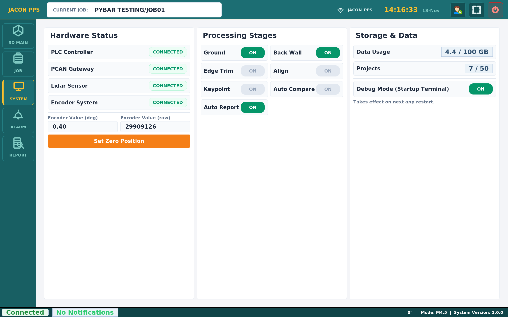
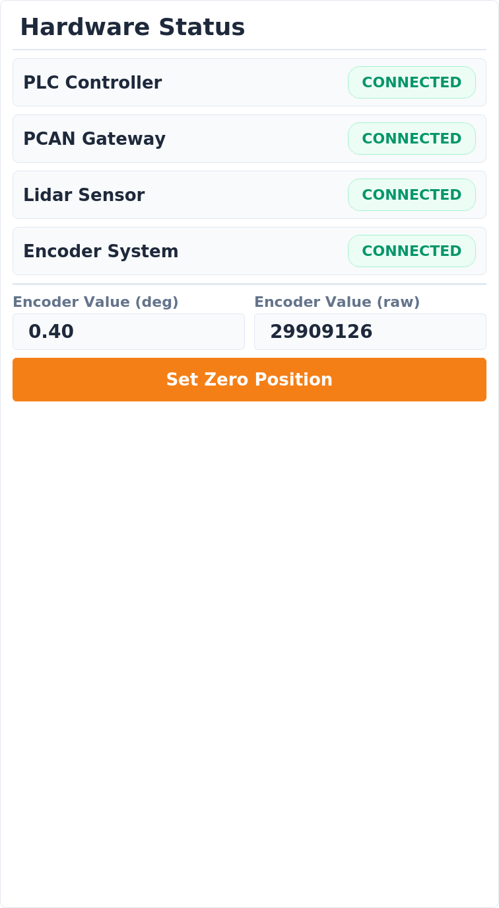
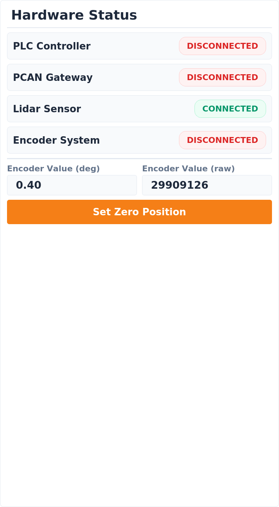
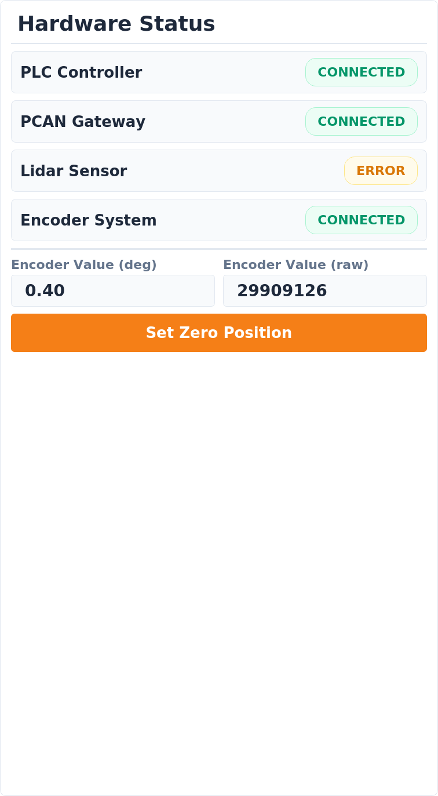
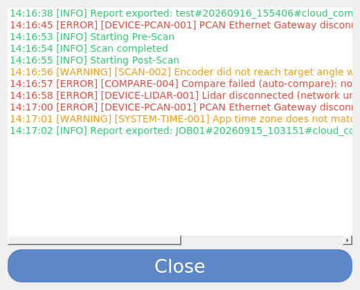
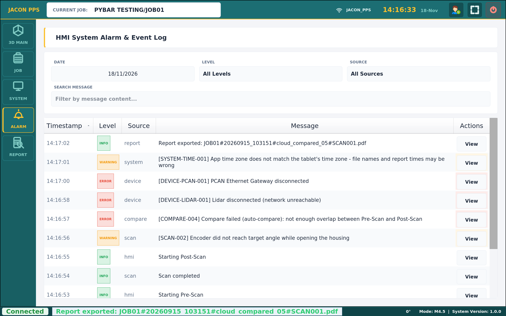
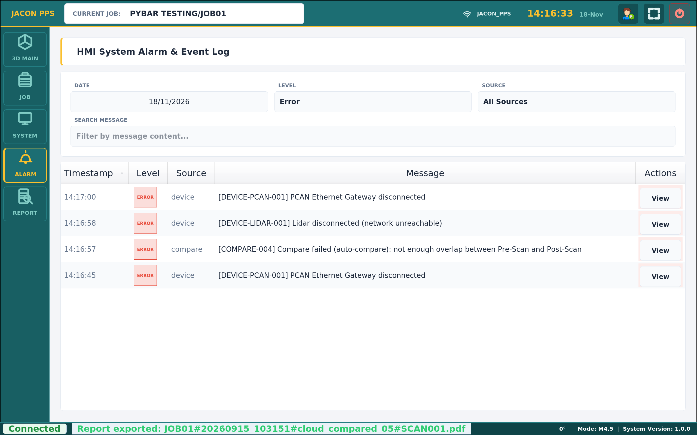
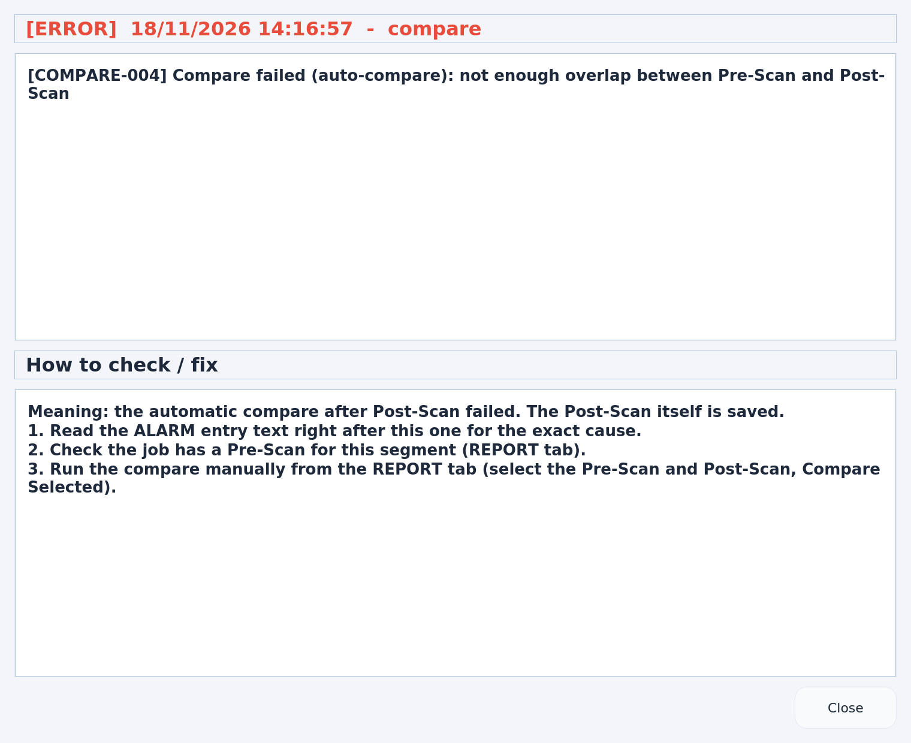

# 9. Status Lights, Notifications & the ALARM Log

The machine tells you about problems in five places:

| Where | Tells you |
|-------|-----------|
| **Network indicator** (header) | Whether the tablet is on the machine's router at all (Chapter 5.1.1). |
| **Clock** (header) | The time used for file names and reports (Chapter 5.1.2). |
| **SYSTEM** tab | Live connection light of each device. |
| **Status bar** | The latest message. |
| **ALARM** tab | Full log of every message, with a fix guide for each coded alarm. |

## 9.1 Device lights — SYSTEM tab

The **Hardware Status** card (left) shows one light per device:

| Device | CONNECTED means | If DISCONNECTED | Alarm code |
|--------|-----------------|-----------------|------------|
| **PLC Controller** | The PLC's heartbeat is arriving over CAN (every few seconds). | Housing will not move. | DEVICE-PLC-001 |
| **PCAN Gateway** | CAN messages are arriving through the gateway. | Nothing from the machine reaches the tablet — PLC and Encoder go red too. | DEVICE-PCAN-001 |
| **Lidar Sensor** | The scanner answers on the network **and** is sending scan data. | Scans locked. **ERROR** (amber) = reachable on the network but no scan data. | DEVICE-LIDAR-001 (disconnected) / DEVICE-LIDAR-002 (error) |
| **Encoder System** | Encoder messages are arriving over CAN. | Scans locked; Housing angle unknown. | DEVICE-ENCODER-001 |

A light goes red about 3–5 seconds after the signal stops and back to green as soon as it returns.

 

Consequences:

- **Status bar badge** = **Connected** only when all four are green.
- **PRE-SCAN / POST-SCAN** are enabled only when **Encoder** and **Lidar** are green.
- Each time a device goes DISCONNECTED/ERROR (and at start-up if it is already down) an **alarm with its code** appears on the status bar and in the ALARM log, with a step-by-step fix guide (Chapter 10.2).

Reading several red lights together:

| What is red | Most likely cause | Start with |
|-------------|-------------------|------------|
| All four + header **NO NETWORK** | Tablet not on the router | Chapter 10.1 |
| All four, network shown OK | Router or wrong Wi-Fi network | Chapter 10.1, then DEVICE-PCAN-001 |
| PCAN + PLC + Encoder | PCAN gateway or its cable to the router | DEVICE-PCAN-001 |
| PLC + Encoder (PCAN green) | CAN cable PCAN↔PLC or PLC power | DEVICE-PLC-001 |
| Encoder only | Housing motor/encoder power or cable | DEVICE-ENCODER-001 |
| Lidar only | Lidar power / cable / still booting | DEVICE-LIDAR-001 / 002 |

## 9.2 Status bar messages

| Colour | Level | Examples |
|--------|-------|----------|
| Green | Info | *Starting Pre-Scan*, *Scan completed*, *COMPARE DONE*, *Report exported: …* |
| Amber | Warning | *[SCAN-002] Encoder did not reach target…*, *[SYSTEM-TIME-001] …*, storage clean-up notices |
| Red | Error | *[DEVICE-PCAN-001] …*, *[SCAN-001] …*, *[COMPARE-004] Compare failed …* |

- An error stays on the bar for at least 10 s even if info messages follow.
- Progress ticks (*COMPARE 42%*) are shown but not logged.
- **Tap the message** to open the **Notification history** list of the current session.

## 9.3 ALARM tab

**HMI System Alarm & Event Log** — every logged message, newest first: **Timestamp**, **Level** badge, **Source** (which part of the software), **Message**, and a **View** button. Rows with warnings/errors are tinted. Tap a column header to sort by it.

Filters:

- **DATE** — tap to pick a past day (logs are kept for 365 days). Today's view updates live.
- **LEVEL** — All Levels / Info / Warning / Error. **Opens on "Error"** by default, so an empty table means no errors today.
- **SOURCE** — one software component (e.g. `device`, `scan`, `compare`, `system`).
- **SEARCH MESSAGE** — free text, e.g. a code such as `PCAN`.

### Alarm Detail and the fix guide

**Tap View** (or double-tap the row). A window shows the full message and, for any message with a code (`SCAN-nnn`, `COMPARE-nnn`, `DEVICE-…`, `SYSTEM-…`), a **How to check / fix** list. The window is not blocking — you can keep using the app and drag it aside; **Close** when done.

The same guides, with extra notes, are in Chapter 10.

## 9.4 Messages you will see in normal operation

| Message | Meaning |
|---------|---------|
| *Starting Pre-Scan* / *Starting Post-Scan* | Scan begun. |
| *Opening Housing* / *Closing Housing* | Manual Housing button pressed. |
| *Scan completed* | Cloud captured, Housing closing. |
| *COMPARE xx%* / stage names | Compare running. |
| *COMPARE DONE* | Heatmap ready (and report done if enabled). |
| *Report exported: …* | PDF written. |
| *COMPARE DONE (report export failed)* | Heatmap ready, PDF failed — see Chapter 10.4. |
| *Job canceling…* / *Job canceled* | CANCEL JOB pressed. |
| *Setting home position…* / *Home position set.* | Set Zero Position done. |
| *Superseded pending cloud …* / *A queued compare request was superseded…* | Two requests arrived quickly; only the newest was processed. Harmless. |
| *Data folder over 100 GB cap – deleted … from oldest project …* | Automatic disk clean-up ran at start-up (Chapter 11). |
