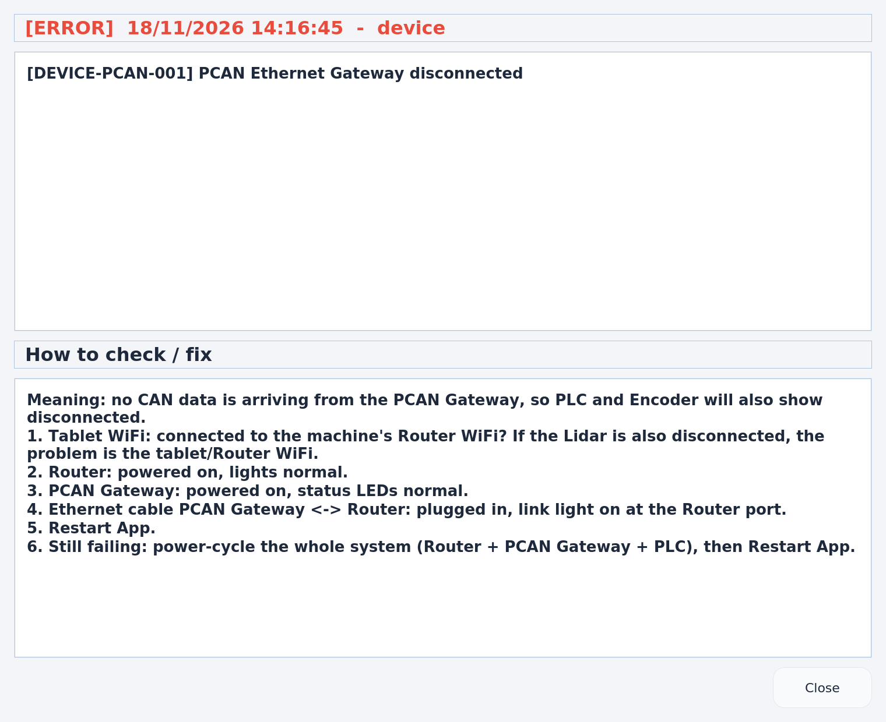
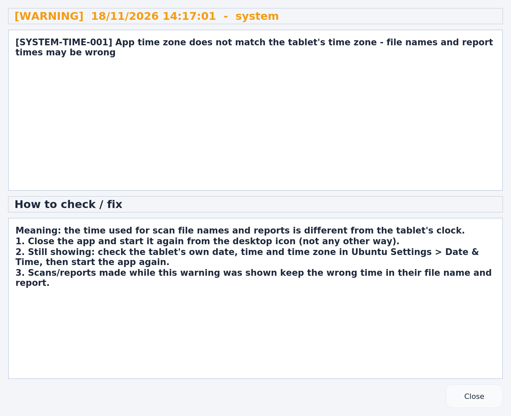

# 10. Troubleshooting & Fixing Errors

How to use this chapter:

1. **Look at the screen first**: header (network, clock), status bar badge, SYSTEM tab lights.
2. **If there is an alarm code**, open it on the ALARM tab (**View**) — the tablet shows the same *How to check / fix* steps as below. Work through the steps **in order**: they start with the cheapest, most likely check.
3. **Stop at the first step that fixes it.** If you reach the end of the list, call support (10.8).

**Restart App** = tap the red **power** button → **Yes**, then tap the **Intelijet** icon (kiosk tablet: switch it off and on).
**Power-cycle** a device = switch it off, wait 10 s, switch it on, wait until it has booted (Lidar ≈ 1 min). Only with the Housing closed and nobody near it (Chapter 2).

Hardware chain the guides assume:

```
Tablet --Wi-Fi/LAN--> Router --Ethernet--> Lidar (SICK LMS511, 192.168.82.121)
                       Router --Ethernet--> PCAN Ethernet Gateway (192.168.82.10)
                                              --CAN bus--> PLC --> Housing motor + Encoder
```

## 10.1 Network (header indicator)

| What you see | What to do |
|--------------|------------|
| Red **NO NETWORK** in the header | 1. Tablet Wi-Fi switched on? Connect it to the **machine's router** Wi-Fi (top-right of the Ubuntu screen), or plug in the LAN cable. 2. Router powered on, lights normal. 3. Still nothing: Restart App; then power-cycle the router and wait ~1 min. The device lights recover by themselves once the network is back. |
| Wi-Fi shown, but with a **different network name** than the machine's router | The tablet joined another network (site Wi-Fi, phone hotspot). Switch it to the machine's router — devices cannot be reached otherwise. |
| Wi-Fi shown with **1 bar** and devices keep dropping in and out | Signal weak. Move the tablet closer to the router, remove obstructions, or use a LAN cable. |
| Network shown OK, but **all four** devices DISCONNECTED | Router itself or its cabling: check router power and lights, then DEVICE-PCAN-001 and DEVICE-LIDAR-001 below. |


## 10.2 Device alarms (SYSTEM tab lights)

Fix them in this order: **network (10.1) → PCAN → PLC → Encoder**, and Lidar separately — a PCAN fault also explains PLC and Encoder being down.



### DEVICE-LIDAR-001 — Lidar disconnected (network unreachable)

The tablet cannot reach the Lidar on the network at all (power, cable or network problem).

1. Tablet Wi-Fi: connected to the machine's Router Wi-Fi (not another network)? Check the SYSTEM tab — if PCAN Gateway is also disconnected, the problem is the tablet/Router Wi-Fi, not the Lidar.
2. Router: powered on, lights normal.
3. Lidar: powered on (status LED on).
4. Ethernet cable Lidar ↔ Router: plugged in at both ends, link light on at the Router port, cable not damaged.
5. Restart App.
6. Still failing: power-cycle the whole system (Router + Lidar), wait ~1 min, then Restart App.

### DEVICE-LIDAR-002 — Lidar network is reachable but no scan data is coming in

The network to the Lidar is fine, but no scan data is coming from it (still starting up, or stuck). SYSTEM tab shows Lidar **ERROR** (amber).

1. If the Lidar was just powered on, wait ~1 minute for it to finish booting.
2. Restart App.
3. Still failing: power-cycle the Lidar only, wait ~1 min, then Restart App.
4. Check the Lidar front window is not covered/dirty and its status LED shows no error.

### DEVICE-PCAN-001 — PCAN Ethernet Gateway disconnected

No CAN data is arriving from the PCAN Gateway, so PLC and Encoder will also show disconnected.

1. Tablet Wi-Fi: connected to the machine's Router Wi-Fi? If the Lidar is also disconnected, the problem is the tablet/Router Wi-Fi.
2. Router: powered on, lights normal.
3. PCAN Gateway: powered on, status LEDs normal.
4. Ethernet cable PCAN Gateway ↔ Router: plugged in, link light on at the Router port.
5. Restart App.
6. Still failing: power-cycle the whole system (Router + PCAN Gateway + PLC), then Restart App.

### DEVICE-PLC-001 — PLC disconnected

The tablet is not receiving any signal from the PLC (it comes through the PCAN Gateway).

1. SYSTEM tab: is the PCAN Gateway CONNECTED? If not, fix DEVICE-PCAN-001 first (that also explains this one).
2. PLC: powered on, in RUN mode, no fault light.
3. CAN cable PLC ↔ PCAN Gateway: plugged in at both ends, not damaged.
4. Restart App.
5. Still failing: power-cycle the PLC, wait until it boots, then Restart App.

### DEVICE-ENCODER-001 — Encoder disconnected

No encoder (Housing angle) data is arriving. Encoder data comes from the Housing motor through the PLC and PCAN Gateway.

1. SYSTEM tab: is the PCAN Gateway CONNECTED? If not, fix DEVICE-PCAN-001 first.
2. Is the PLC CONNECTED? If not, fix DEVICE-PLC-001 first.
3. PCAN and PLC both fine, only Encoder down: check power to the Housing motor/drive, and the CAN cable to the motor/encoder (connectors seated, no damage).
4. Restart App.
5. Still failing: power-cycle the whole system, then Restart App.

## 10.3 Scan errors

| Code / what you see | Meaning | What to do |
|---------------------|---------|------------|
| **PRE-SCAN / POST-SCAN grey** | Encoder or Lidar is not CONNECTED. | Fix the red device (10.2); the buttons turn yellow by themselves. |
| **SCAN-001** *Failed to assemble point cloud* | The scan ran but no point cloud came out of the Lidar. | 1. SYSTEM tab: Lidar CONNECTED? If not, DEVICE-LIDAR-001/002 first. 2. Make sure the Housing actually opened during the scan (the Lidar must see the tunnel, not the inside of the Housing). 3. Retry once. 4. Restart App. 5. Power-cycle the Lidar (wait ~1 min), then Restart App. |
| **SCAN-002** *Encoder did not reach target angle while opening* (warning) | The motor was told to open, but the angle did not reach the open position in time. | 1. Look at the Housing: debris, shotcrete build-up or cables blocking it? Clear it. 2. SYSTEM tab: Encoder CONNECTED and its angle changing while the Housing moves? Angle not changing but Housing moves → DEVICE-ENCODER-001. Housing does not move → SCAN-005. 3. Hold **OPEN HOUSING** and watch the angle; it should reach the open angle smoothly. 4. Stops at the same angle every time: check for an obstruction there; if none, contact engineering. |
| **SCAN-003** *Encoder did not reach target angle while closing* (warning) | The Housing did not get back to closed in time. | 1. Anything blocking it from closing? Clear it. 2. Same encoder/motor checks as SCAN-002. 3. Hold **CLOSE HOUSING** and watch the angle; it should return to ~0°. 4. Housing physically closed but angle not ~0: **Set Zero Position** (SYSTEM tab) with the Housing fully closed. |
| **SCAN-004** *Scan failed* | The Pre-/Post-Scan sequence stopped with an error. | 1. ALARM tab: read the entries just before/after this one — they usually name the real cause. 2. SYSTEM tab: all four devices CONNECTED (fix any that are not). 3. Housing fully closed, then retry. 4. Restart App. |
| **SCAN-005** *Housing move failed* | The command to move the Housing did not complete. | 1. Housing blocked or jammed? Clear it. 2. SYSTEM tab: PLC and PCAN CONNECTED (command path: Tablet → Wi-Fi → Router → PCAN → CAN → PLC → motor). If not, DEVICE-PCAN-001 / DEVICE-PLC-001 first. 3. PLC/motor powered, no emergency stop pressed. 4. Retry OPEN/CLOSE HOUSING. 5. Power-cycle the PLC/motor control box, wait until PLC shows CONNECTED, retry. |
| **SCAN-006** *Unsupported active_lidar value* | Settings error, not a hardware fault. | 1. Restart App. 2. Still showing: do not change any files — contact engineering. |
| **SCAN-007 / SCAN-008** *Pre-/Post-Scan cloud preprocessing failed* | The cloud arrived but could not be cleaned up/cropped. The scan is **not saved**. | 1. Read the ALARM entry right after this one for the cause. 2. Empty or tiny cloud: check the Housing opened and nothing covers the Lidar window. 3. Retry the scan. 4. Restart App. |
| **SCAN-009** *Scan pipeline error while processing a scan cloud* | Saving/displaying the cloud failed on the tablet. | 1. Read the error text in the ALARM entry. 2. SYSTEM tab → **Storage & Data**: a full disk stops files being saved (Chapter 11.2). 3. A job is selected in the header (CURRENT JOB). 4. Retry; still failing: Restart App. |
| **SCAN-010** *Failed to color point cloud for display* (warning) | Only the on-screen colours failed. The saved data is valid. | 1. Keep working. 2. If it repeats on every cloud: check the job's Target Thickness / Tolerance are filled in with numbers (JOB tab). |
| Button has a **red frame** | The last scan of that kind failed. | Read the ALARM tab, fix, scan again — the frame clears when a scan runs. |
| Housing stopped half-open after **CANCEL JOB** | Expected. | Hold **CLOSE HOUSING** until closed. |
| Housing does not move at all (scan or manual) | No power/communication to the PLC. | Vehicle **emergency** control released? Ignition on? **PLC Controller** + **PCAN Gateway** green? Then retry (SCAN-005). |
| Scan finished but the cloud looks wrong / partial | Arm moved, wall too far, or zero angle wrong. | Reposition, check Chapter 7.2 step 7, scan again. |

## 10.4 Compare & report errors

| Code / what you see | Meaning | What to do |
|---------------------|---------|------------|
| **COMPARE-001** *Compare finished with success=False* | The compare ran but could not produce a valid result. | 1. Read the ALARM entries around this one. 2. Pre- and Post-Scan taken from the same machine position and covering the same section? 3. Retry from the REPORT tab (8.5). 4. Still failing: take a new Post-Scan without moving the machine. |
| **COMPARE-002** *Compare timed out* | No result within 2 minutes. | 1. Very large scans can be slow — wait a moment, retry once from the REPORT tab. 2. Restart App and retry. 3. Keeps happening: contact engineering. |
| **COMPARE-003** *Post-process crop step failed, using the uncropped cloud* (warning) | The **Edge Trim** step failed; a result was still produced, but its edges were not trimmed to the Pre-Scan area. | 1. Check the result in the 3D view — extra areas at the edges may be included in the report numbers. 2. If it looks wrong, retry the compare. 3. Keeps failing: an admin can switch **Edge Trim** OFF (SYSTEM tab); report it to engineering. |
| **COMPARE-004** *Compare failed (auto-compare)* | The automatic compare after Post-Scan failed. The Post-Scan itself is saved. | 1. Read the ALARM entry right after this one. 2. Check the job has a Pre-Scan for this segment (REPORT tab). 3. Run the compare by hand: select the Pre-Scan and Post-Scan, **Compare Selected** (8.5). |
| **COMPARE-005** *Compare failed (manual compare)* | The compare started from the REPORT tab failed. | 1. Read the ALARM entry right after this one. 2. One Pre-Scan and one Post-Scan from the **same segment** selected? 3. Retry; still failing: Restart App and retry. |
| **COMPARE-006** *Compare failed* | The compare server reported a failure. | 1. Read the ALARM entries around this one. 2. Pre-Scan and Post-Scan of the same segment? 3. Retry; still failing: Restart App and retry. |
| No heatmap after POST-SCAN, no compare messages | **Auto Compare** is OFF. | Admin: SYSTEM tab → Auto Compare ON. Or compare by hand (8.5). |
| *COMPARE DONE* but no PDF / **Report** button grey | **Auto Report** OFF, or export failed. | SYSTEM tab → **Auto Report ON**, then redo the compare (8.5). If *Report export failed* appeared: check disk space (Storage & Data); technician. |
| *COMPARE DONE (report export failed)* | Heatmap OK, PDF failed. | Same as above. |
| Report note: *… points exceed the measurable range … excluded* (many points) | Large parts of the result are over 300 mm. | Usually the Pre- and Post-Scan were not taken from the same position, or equipment was in view. Check the heatmap; redo the Post-Scan if needed. |
| **Heatmap** button grey on a Post-Scan row | That Post-Scan was never compared. | **Compare Selected** with its Pre-Scan. |
| PDF viewer does not open / opens behind the app | Viewer problem. | Tap **Report** again; tap the viewer window in the task list. Technician if never. |

## 10.5 Jobs & data

| What you see | What to do |
|--------------|------------|
| **CURRENT JOB** dropdown is empty | No job is scheduled. JOB tab → **Schedule** a job (Chapter 6.3). |
| *Cannot edit / delete an active job* | The job is Scheduled. Remove it from the Work Schedule first (✕, Chapter 6.5). |
| *Cannot rename / delete a project with active jobs* | Remove all its jobs from the schedule first. |
| Rename refused because the project/job already has scan data | By design — renaming would break the links to its scans and reports. Create a new project/job instead. |
| *Project / Job already exists* | Pick another name. |
| Job created on the other tablet is missing | Wait for sync (Chapter 12) — the CURRENT JOB list refreshes every 30 s, the JOB/REPORT tabs when opened. |
| A file named `…sync-conflict…` shows up | Both tablets changed the same file. See Chapter 12. |
| Status bar: *Data folder over 100 GB cap … deleted …* | Automatic clean-up removed raw scans from the **oldest** project (never from scheduled jobs). Heatmaps and PDFs are kept. Copy old projects to USB if you need the raw scans (Chapter 13). |
| *… no more space can be freed automatically* (warning) | Disk full and everything left is scheduled. Finish/Remove old jobs, delete old projects, or copy to USB then delete. |

## 10.6 Time & clock

| What you see | What to do |
|--------------|------------|
| **SYSTEM-TIME-001** *App time zone does not match the tablet's time zone* (warning) | The time used for scan file names and reports differs from the tablet's clock. 1. Close the app and start it again **from the desktop icon** (not any other way). 2. Still showing: check the tablet's own date, time and time zone in Ubuntu **Settings → Date & Time**, then start the app again. 3. Scans/reports made while this warning was shown keep the wrong time in their file name and report. |
| Header clock shows the wrong time but no SYSTEM-TIME-001 | The tablet's own clock is wrong. Technician: Ubuntu **Settings → Date & Time** (turn on automatic time if the tablet has internet), then Restart App. |



## 10.7 Start-up, screen & general

| What you see | What to do |
|--------------|------------|
| Nothing appears after tapping the icon / the tablet boots to a black screen or keeps rebooting | Wait 2 min (first start after an update builds the software). Then power-cycle the tablet. If it still fails: technician — Chapter 3.3 (`kiosk_mode.sh restore`) and Chapter 11.6 (logs). |
| Status bar says **Disconnected** | SYSTEM tab → find the red device → 10.2. |
| On-screen keyboard does not appear | Tap the field again. If never: technician — restart the app; check `onboard` is installed in the image. |
| App is not full screen / window too small | Tap **⛶**. |
| Screen the wrong way round | Restart App (the launcher re-applies the rotation). |
| App frozen for more than 2 min | Tap the icon / power-cycle the tablet. Note the time and what you were doing for the technician. |
| Wrong password | Ask the administrator. |

## 10.8 Before calling support

Have ready:

1. The **ALARM** row (**View** → detail text, code, time) — or a photo of the screen.
2. What the header showed (network, clock) and which lights were red on the SYSTEM tab.
3. What you were doing (Pre-Scan / Post-Scan / manual housing / compare) and which fix steps you already tried.
4. The job and segment (REPORT tab).
5. Technician: the day's alarm file `data/logs/YYYYMMDD.jsonl` and the start-up logs `data/logs/last_run.log` (Chapter 11.6).

> ⚠️ **NEEDS CONFIRMATION** — support contact (name, phone, email).
