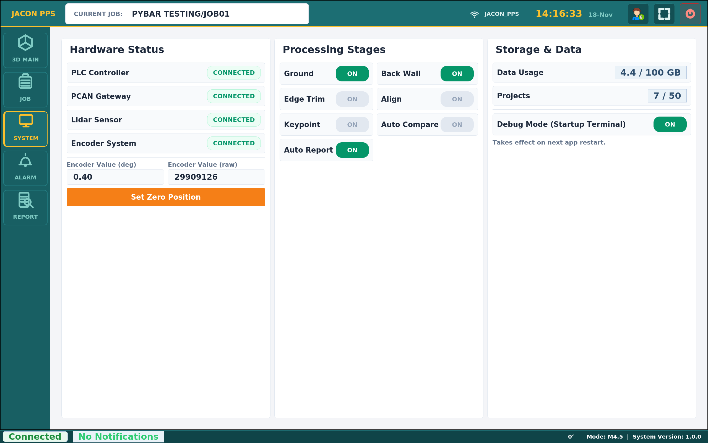

# 11. Maintenance & Updates (technicians)

## 11.1 Software update

```bash
cd ~/intelijet_v2
git pull
docker compose build
```

Then start the app normally. Do this between shifts, not during a job. The **Mode** and **System Version** shown on the status bar come from `config/machine_info.yaml` — update `version:` there when you deploy.

## 11.2 Disk space and automatic clean-up



The SYSTEM tab's **Storage & Data** card shows the current **Data Usage** and **Projects** against their caps. Every start of the app runs a one-time clean-up of `data/Projects/` according to `config/storage_cleanup.yaml`:

| Setting | Default | Effect |
|---------|---------|--------|
| `max_data_gb` | 100 | If the folder is larger: delete the **raw Pre-/Post-Scan `.ply` files** from the oldest project(s) until under the cap. Heatmaps, PDFs and `job_info.json` are kept. |
| `max_projects` | 50 | If there are more projects: delete the oldest project(s) entirely. |

Projects that have a job on the **Work Schedule** are never touched. Each action is reported on the status bar / ALARM tab (*Data folder over … cap …*). Keep the machine tidy anyway: **Done** old jobs, copy finished projects to USB (Chapter 13) and delete them.

## 11.3 Back-ups

- `data/Projects/` — all scans, heatmaps, reports, job settings. The two tablets mirror it (Chapter 12); take a USB copy of finished projects regularly.
- `intelijet_v2_ws/src/config/*.yaml` — machine configuration (see 11.4). Back up after any change.

## 11.4 Configuration files (`intelijet_v2_ws/src/config/`)

| File | Contains | Restart needed? |
|------|----------|-----------------|
| `machine_info.yaml` | **Mode** and **System Version** shown on the status bar. | Yes |
| `error_codes.yaml` | Message, level and **How to check / fix** text for every SCAN-/COMPARE-/DEVICE-/SYSTEM- code. Edit to improve the on-screen guidance (Chapter 10 copies it). | No |
| `storage_cleanup.yaml` | Clean-up caps (11.2). | No (next start) |
| `devices.yaml` | Which devices/nodes are monitored, the scanner IP (`192.168.82.121`), time-outs, and which alarm code each device raises. | Yes |
| `runtime.yaml` | Housing start/end angles (12° / 135°), open/close speeds, default thickness/tolerance, `thickness.max_measurable` (300 mm), compare parameters, report camera, network-indicator thresholds. | Yes |
| `lidar.yaml` | Active scanner type (`lms511`). | Yes |
| `last_used.yaml` | Auto-generated merge of the above; delete it to regenerate after editing `commond/lidar/runtime.yaml`. | — |

Edit with a text editor on the tablet or over SSH; keep a copy of the original.

## 11.5 Encoder zero calibration

The Housing angle must read 0° when fully closed. Recalibrate after mechanical work on the Housing/encoder or if scans stop early: close the Housing (**CLOSE HOUSING**), then **SYSTEM → Set Zero Position → Yes** (Chapter 7.2).

## 11.6 Logs

| Log | Where | Use |
|-----|-------|-----|
| Alarm/event log per day | `data/logs/YYYYMMDD.jsonl` (kept 365 days) | Same content as the ALARM tab; attach to support requests. |
| Application start-up log | `data/logs/last_run.log` (this run) and `previous_run.log` | Why the app did not start; software crashes. |
| Start-up terminal | Shown at start when **Debug Mode** is ON (SYSTEM tab, next restart) | Watching the start-up live on site. |
| Live log while running | `docker compose logs -f` in the repository folder | Debugging on site. |

## 11.7 Persistent settings

Switch positions (SYSTEM tab), the last selected job, PDF viewer and keyboard preferences are stored under `data/.config/` and `intelijet_v2_ws/src/config/.config/`, so they survive restarts and updates. Folders whose names start with a dot are hidden from the project/job lists.

## 11.8 Updating the manual screenshots

After a UI change, re-capture every picture in this manual from the real software and rebuild the HTML copy:

```bash
cd ~/intelijet_v2
docs/manual/tools/capture_screenshots.sh
```

Close the Intelijet app first. The app window shows full-screen for about a minute while the pictures are taken. The script only reads data: it uses the current job as it is, writes its test alarms to a temporary folder, and never saves settings. Rebuilding the HTML needs the Python `markdown` package on the host (`sudo apt install python3-markdown`).

## 11.9 Hardware

Keep the scanner window clean and the Housing path free of debris. Check cables (encoder, CAN, scanner and gateway Ethernet, router) for damage when a device light goes red repeatedly.

> ⚠️ **NEEDS CONFIRMATION** — manufacturer maintenance intervals for the scanner, Housing motor, hydraulic arm and cylinder.
